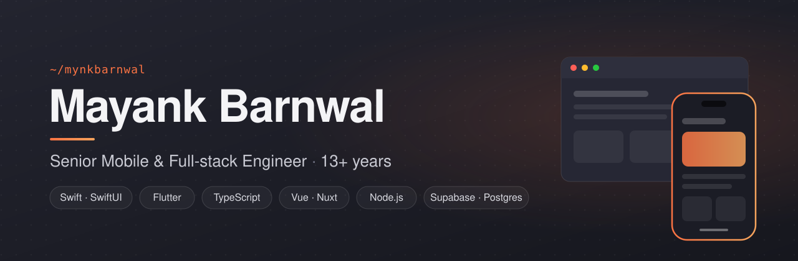

   

### Hi, I'm Mayank Barnwal

## About me
Senior Mobile & Full-stack Engineer with **13+ years** of experience building, shipping, and maintaining production apps. iOS is my home turf (**Swift**, **SwiftUI**, **UIKit**, **Objective-C**), and today I build the whole product too: web frontends, backends, databases, and cross-platform apps with **Flutter**. I care about clean architecture, performance, and delightful UX.

- **iOS**: Swift, SwiftUI, UIKit, Objective-C, Core Data, networking layers, testing
- **Web / Backend**: TypeScript, Vue / Nuxt, Node.js, REST APIs, PostgreSQL, Supabase, Prisma / Drizzle
- **Cross-platform**: Flutter / Dart
- **DevOps**: Docker, Railway, CI/CD, App Store delivery
- **Education**: Computer Science graduate
- **Pronouns**: He/Him

## Live / beta apps
- [PeerPicks](https://apple.co/4cSBee0)
- [Ploff](https://apple.co/3xSpjhB)
- [HOP](https://apps.apple.com/in/app/hop/id1571993960)
- [IASS](https://apps.apple.com/in/app/iass/id1459625250)
- [MahakaalVaani](https://apps.apple.com/in/app/mahakal-vaani/id1492150303)

## GitHub stats

<!-- -->

## Connect with me

   

## Languages and tools

**Mobile**

      

**Web / Backend**

      

**DevOps & Design**

   
